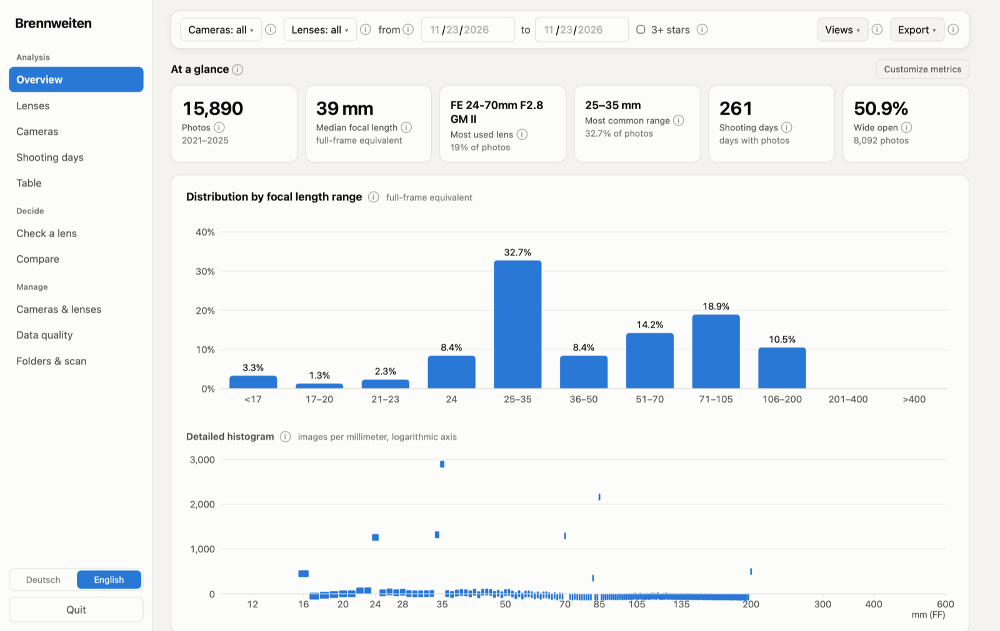
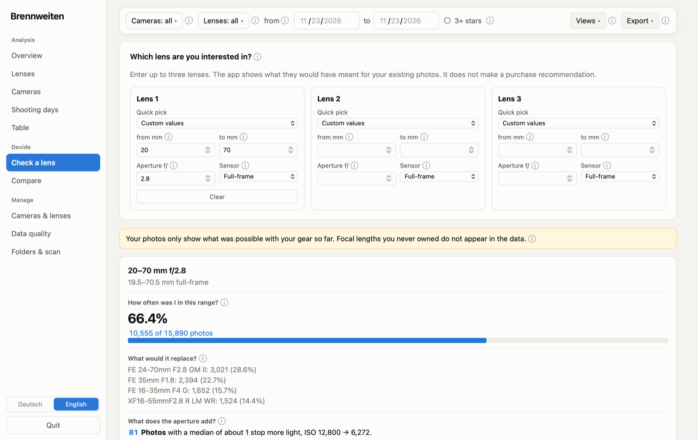
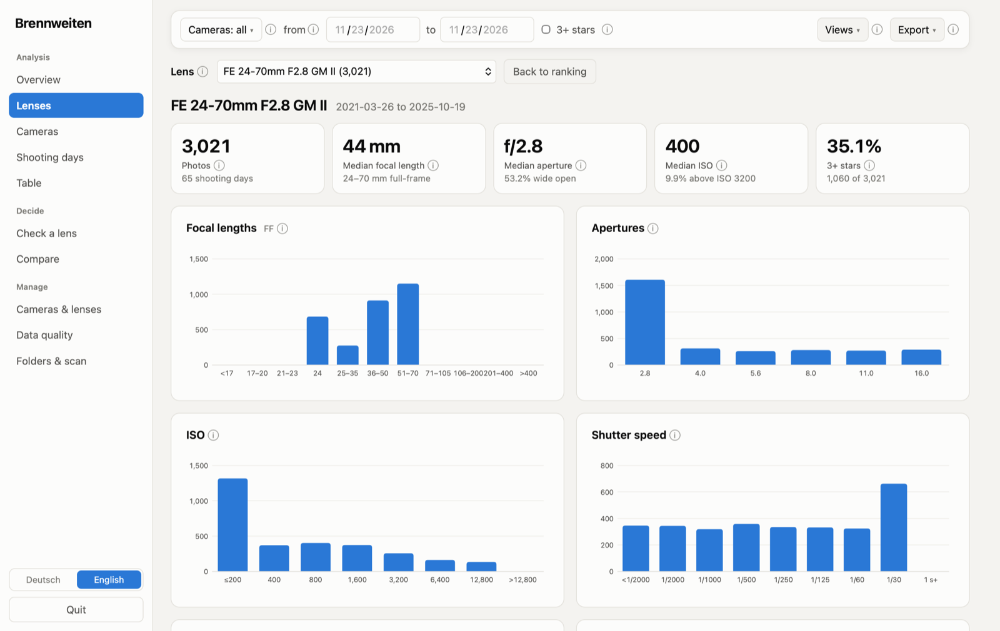
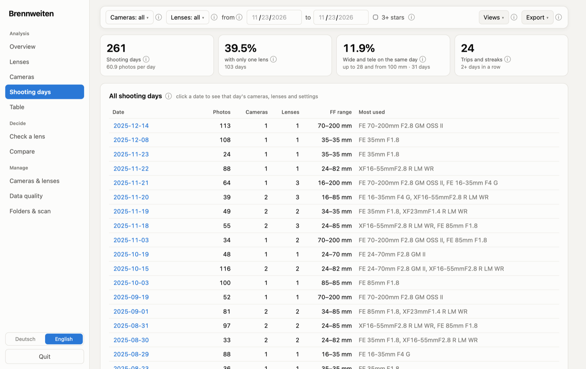

# Brennweiten

**Deutsch** · [English](README.md)

[](https://github.com/mft6s2t24t-lgtm/brennweiten/releases/latest) [](https://github.com/mft6s2t24t-lgtm/brennweiten/actions/workflows/test.yml)  [](LICENSE)

**Welche Brennweiten nutzt du wirklich?** Wähle deine Fotoordner in dieser kostenlosen Mac-App und sieh, wie du tatsächlich fotografierst, bevor du das nächste Objektiv kaufst.

**[⬇ Für Mac laden](https://github.com/mft6s2t24t-lgtm/brennweiten/releases/latest/download/Brennweiten.dmg)** · Apple Silicon und Intel · macOS 12.3+ · kein Konto



*Die Screenshots zeigen erfundene Demodaten in der englischen Ansicht. Die App gibt es auch komplett auf Deutsch.*

## In 2 Minuten ausprobieren

1. [`Brennweiten.dmg` laden](https://github.com/mft6s2t24t-lgtm/brennweiten/releases/latest/download/Brennweiten.dmg), öffnen und **Brennweiten** in den Ordner **Programme** ziehen.
2. App öffnen. macOS blockiert den ersten Start, weil die App nicht von Apple beglaubigt ist. Unter **Systemeinstellungen → Datenschutz & Sicherheit** auf **Dennoch öffnen** klicken und die eingebauten Programmteile einmal freigeben.
3. Einen Fotoordner wählen. Für den ersten Eindruck reicht ein kleiner Ordner.

Deine Fotos werden nur gelesen. Wie du die App wieder entfernst, steht in der [Anleitung](LIESMICH.md#deine-daten). Lieber erst prüfen? Du kannst sie auch [selbst bauen](#selbst-bauen).

**Ausprobiert?** Schreib in einem [Issue](../../issues/new/choose), was geklappt hat und was nicht. Rückmeldungen zu anderen Kameramarken helfen besonders.

## Warum deine Fotos sicher bleiben

- **Nur lesend:** Fotos werden nie verändert, verschoben oder umbenannt.
- **Komplett lokal:** Keine Cloud, kein Konto, kein Tracking. Die App braucht kein Internet.
- **Keine Zusatzinstallation:** Python und ExifTool sind im App-Paket enthalten.
- **Keine Kaufempfehlung:** Die App zeigt Zahlen und Fakten, die Entscheidung bleibt bei dir.
- **Zweisprachig:** Deutsch und Englisch, beim ersten Start passend zur Sprache deines Macs und jederzeit umschaltbar.

## Funktionen

| Bereich | Was du bekommst |
|---|---|
| **Übersicht** | Frei wählbare Kennzahlen, Brennweitenverteilung, meistgenutzte Objektive, Entwicklung pro Jahr |
| **Objektive** | Rangliste und Detailanalyse mit Blenden, Zoom am Anschlag, Offenblende bei wenig Licht und Trefferquote |
| **Kameras** | Rangliste und Detailanalyse mit Brennweiten, Objektiven, ISO und Belichtungszeiten |
| **Fototage** | Auswertung einzelner Tage und Reisen nach Kameras, Objektiven und Einstellungen |
| **Tabelle** | Alle Fotos mit Excel-artigen Filtern, Sortierung und CSV-Export |
| **Objektiv prüfen** | Bis zu drei Wunschobjektive gegen deine bisherigen Fotos prüfen |
| **Vergleich** | Objektive, Kameras oder Zeiträume nebeneinander |
| **Verwaltung** | Objektivnamen vereinheitlichen, Crop-Faktoren prüfen, Datenqualität, Ordner auf SSD oder NAS |

Unterstützt werden NEF, NRW, CR2, CR3, JPG, HEIF, TIFF und DNG. Alle Brennweiten werden auf Kleinbild (KB) umgerechnet.

## Mehr sehen

| Objektiv vor dem Kauf prüfen | Ein Objektiv analysieren |
|---|---|
|  |  |



Die ausführliche Bedienung steht in der [Anleitung](LIESMICH.md).

## Selbst bauen

Du brauchst die Xcode Command Line Tools und ExifTool über Homebrew:

```bash
xcode-select --install
```

```bash
brew install exiftool
```

```bash
build/baue_app.sh
```

Das Skript lädt eine geprüfte Python-Laufzeit (SHA-256) und legt `Brennweiten.dmg` und `Brennweiten.zip` in `dist/` ab.

Selbsttest mit erzeugten Testbildern:

```bash
bash test/make_testfotos.sh && python3 test/check.py
```

## Aufbau

| Pfad | Inhalt |
|---|---|
| `app/` | Lokaler Python-Server (nur Standardbibliothek), SQLite und Auswertungen |
| `app/web/` | Oberfläche in HTML, CSS und JavaScript ohne Frameworks |
| `native/` | Mac-Fenster in Swift |
| `build/` | Build-Skript und App-Icon |
| `test/` | Testbild-Generator und Selbsttest |

## Mitmachen

Fehlerberichte, Ideen und Korrekturen sind willkommen, siehe [CONTRIBUTING.md](CONTRIBUTING.md). Besonders hilfreich sind Tests mit Kameras und Objektiven, die noch nicht richtig erkannt werden.

## Entstehung

Idee, Konzept und fachliche Anforderungen stammen vom Projektinitiator, einem Fotografen. Der Code wurde mit [Claude](https://claude.com/claude-code) von Anthropic entwickelt. Ein unabhängiges Code-Review steht noch aus, Hinweise sind deshalb besonders willkommen.

## Lizenz und Hinweise

Der Code steht unter der [MIT-Lizenz](LICENSE). Mitgelieferte Fremdsoftware behält ihre eigenen Lizenzen, siehe [THIRD_PARTY_NOTICES.md](THIRD_PARTY_NOTICES.md).

Die Software wird kostenlos und ohne Gewähr bereitgestellt. Dies ist ein privates, nicht kommerzielles Projekt. Es steht in keiner Verbindung zu Nikon, Canon, Apple oder anderen genannten Herstellern. Genannte Marken gehören ihren jeweiligen Inhabern.
