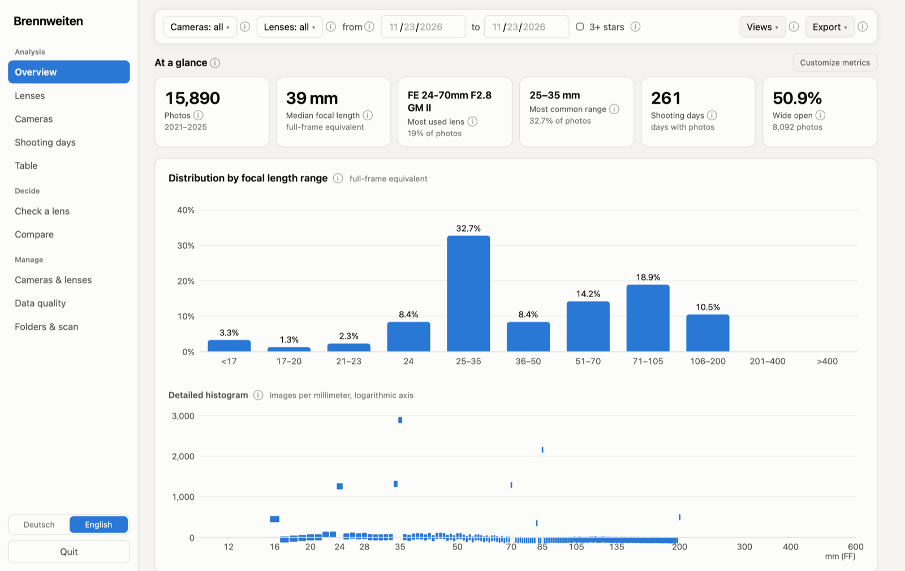
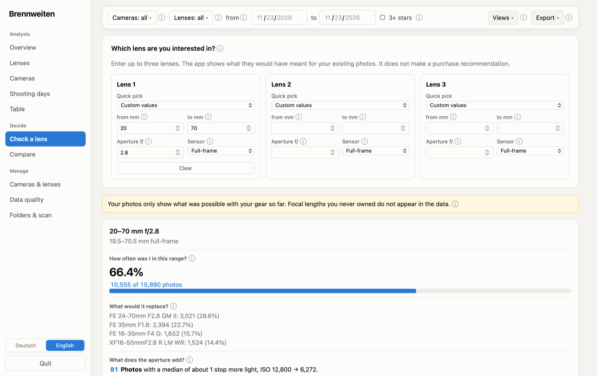
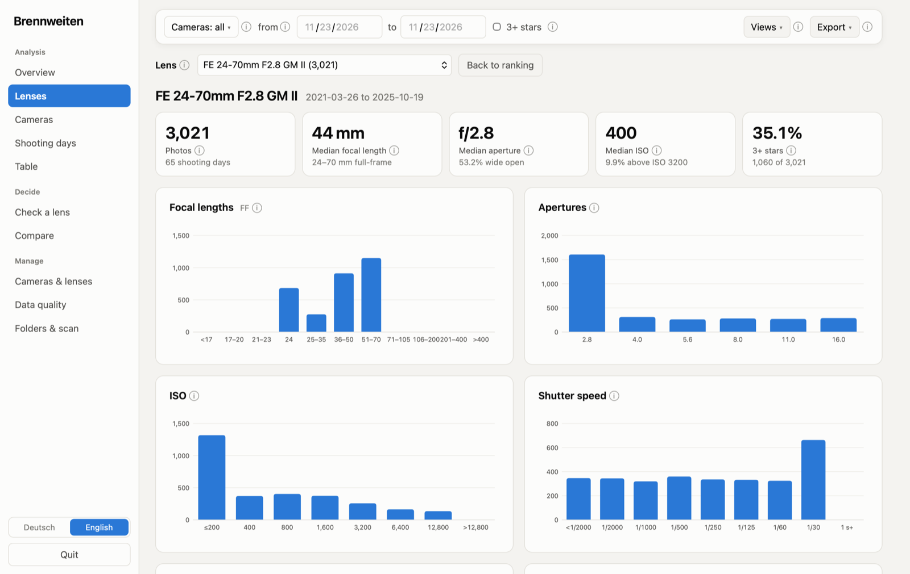
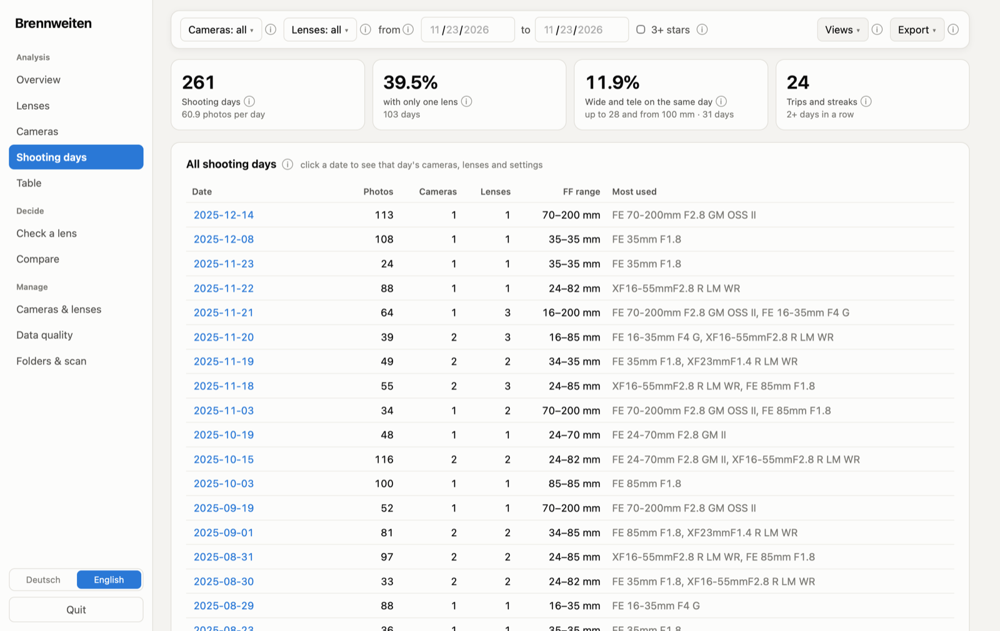

# Brennweiten

[Deutsch](README.de.md) · **English**

[](https://github.com/mft6s2t24t-lgtm/brennweiten/releases/latest) [](https://github.com/mft6s2t24t-lgtm/brennweiten/actions/workflows/test.yml)  [](LICENSE)

**Which focal lengths do you really use?** Point this free Mac app at your photo folders and see how you actually shoot, before you buy your next lens.

**[⬇ Download for Mac](https://github.com/mft6s2t24t-lgtm/brennweiten/releases/latest/download/Brennweiten.dmg)** · Apple silicon and Intel · macOS 12.3+ · no account



*Screenshots use made-up demo data.*

## Try it in 2 minutes

1. [Download `Brennweiten.dmg`](https://github.com/mft6s2t24t-lgtm/brennweiten/releases/latest/download/Brennweiten.dmg), open it and drag **Brennweiten** to **Applications**.
2. Open the app. macOS blocks the first launch because the app is not notarized by Apple. Go to **System Settings → Privacy & Security**, click **Open Anyway**, then allow the bundled components once.
3. Choose a photo folder. A small folder is enough for a first look.

Your photos are only read. To remove the app later, follow the [uninstall steps](GUIDE.md#your-data). Prefer to check first? You can [build it from source](#build-it-yourself).

**Tried it?** Tell me what worked and what did not in an [issue](../../issues/new/choose). Feedback on other camera brands is especially useful.

## Why you can trust it with your photos

- **Read-only:** Photos are never changed, moved or renamed.
- **Fully local:** No cloud, no account, no tracking. The app does not need the internet.
- **Nothing else to install:** Python and ExifTool are included in the app.
- **No purchase advice:** The app shows numbers and facts. The decision stays with you.
- **Bilingual:** English and German. It follows your Mac's language at first launch and can be switched anytime.

## Features

| Section | What you get |
|---|---|
| **Overview** | Customizable metrics, focal length distribution, most used lenses, trends by year |
| **Lenses** | Ranking and detailed analysis with apertures, zoom limits, wide-open use in low light and keeper rate |
| **Cameras** | Ranking and detailed analysis with focal lengths, lenses, ISO and shutter speeds |
| **Shooting days** | Analysis of single days and trips by camera, lens and settings |
| **Table** | All photos with Excel-style filters, sorting and CSV export |
| **Check a lens** | Test up to three lenses you are considering against your existing photos |
| **Compare** | Lenses, cameras or time periods side by side |
| **Manage** | Unify lens names, check crop factors, review data quality, use folders on SSD or NAS |

Supported formats are NEF, NRW, CR2, CR3, JPG, HEIF, TIFF and DNG. All focal lengths are converted to their full-frame equivalent.

## See more

| Check a lens before buying | Analyze one lens |
|---|---|
|  |  |



Full instructions are in the [guide](GUIDE.md).

## Build it yourself

You need the Xcode Command Line Tools and ExifTool from Homebrew:

```bash
xcode-select --install
```

```bash
brew install exiftool
```

```bash
build/baue_app.sh
```

The script downloads a verified Python runtime (SHA-256) and puts `Brennweiten.dmg` and `Brennweiten.zip` in `dist/`.

Self-test with generated test images:

```bash
bash test/make_testfotos.sh && python3 test/check.py
```

## Structure

| Path | Contents |
|---|---|
| `app/` | Local Python server (standard library only), SQLite and analyses |
| `app/web/` | Interface in HTML, CSS and JavaScript without frameworks, English texts in `en.json` |
| `native/` | Mac window in Swift |
| `build/` | Build script and app icon |
| `test/` | Test image generator and self-test |

## Contributing

Bug reports, ideas and fixes are welcome, see [CONTRIBUTING.md](CONTRIBUTING.md). Tests with cameras and lenses that are not detected correctly yet are especially helpful.

## Background

The idea, concept and photographic requirements come from the project's initiator, a photographer. The code was developed with [Claude](https://claude.com/claude-code) by Anthropic. An independent code review is still pending, so feedback is especially welcome.

## License and notices

The code is released under the [MIT License](LICENSE). Bundled third-party software keeps its own licenses, see [THIRD_PARTY_NOTICES.md](THIRD_PARTY_NOTICES.md).

The software is provided free of charge and without warranty. This is a private, non-commercial project. It is not affiliated with Nikon, Canon, Apple or any other manufacturer mentioned. All trademarks belong to their respective owners.
